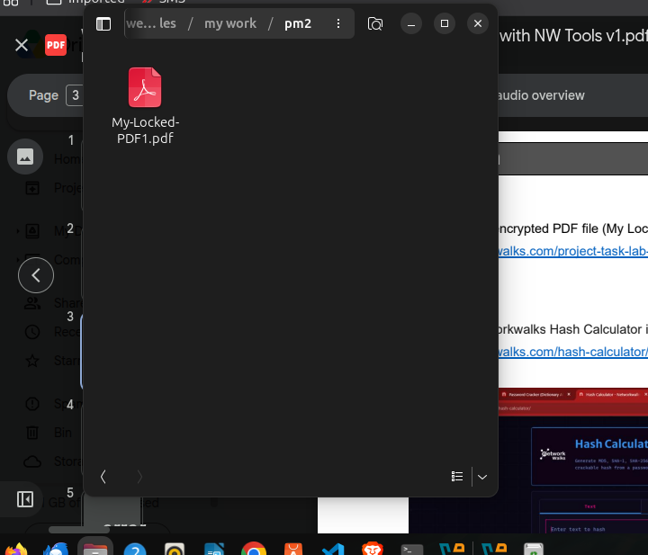
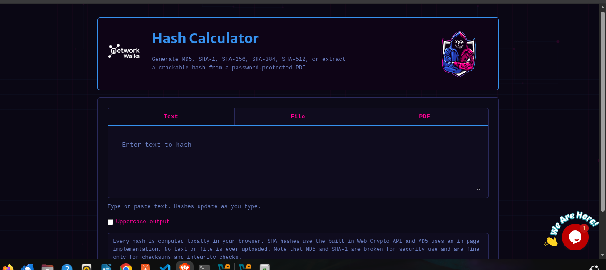
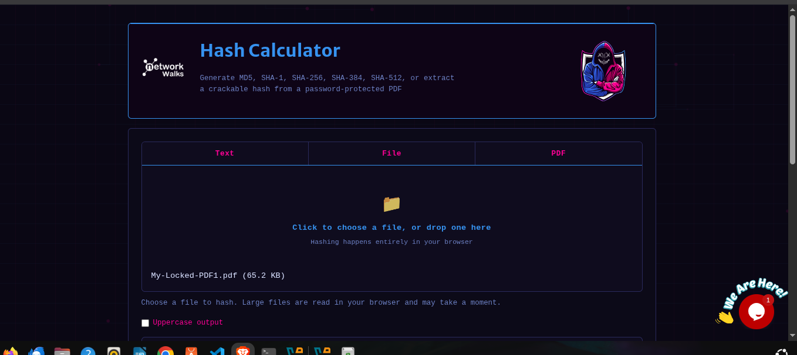
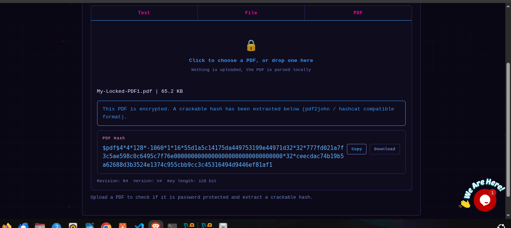
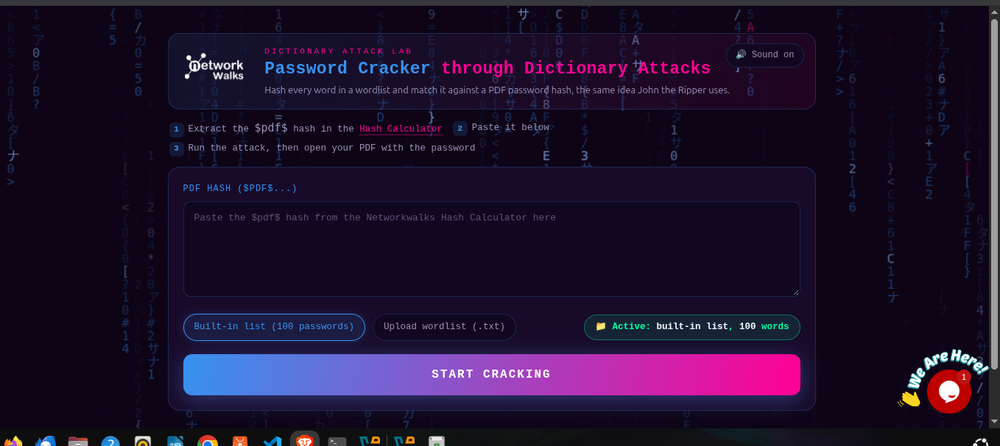
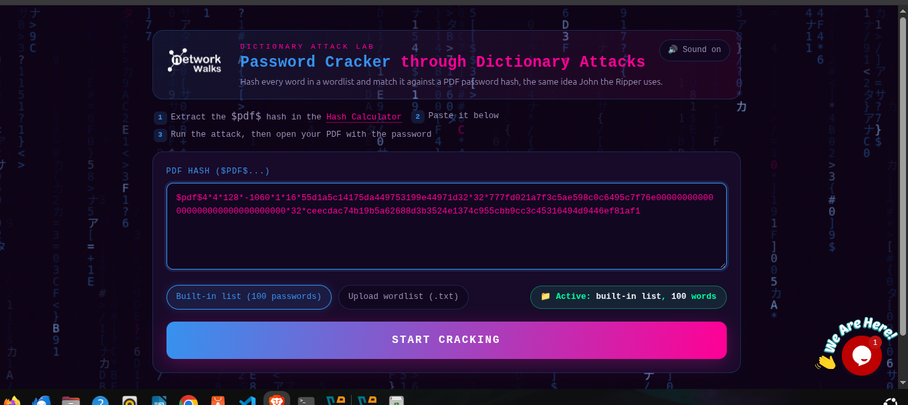
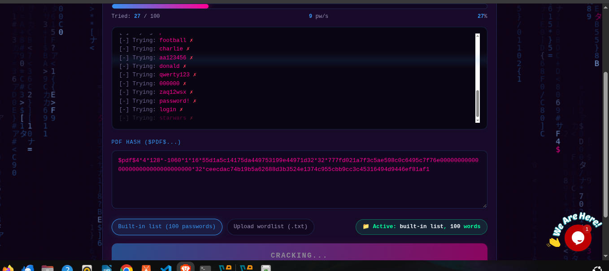
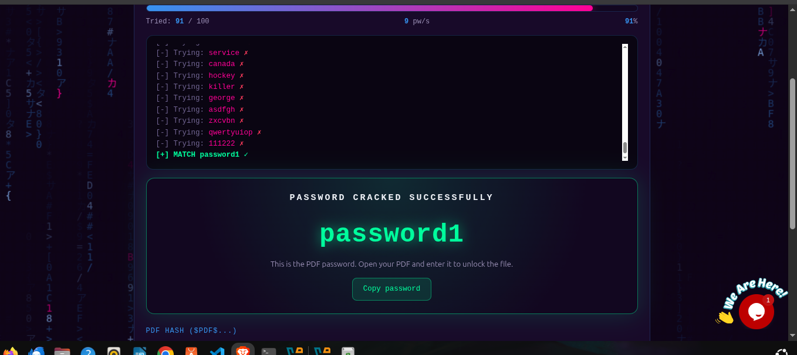
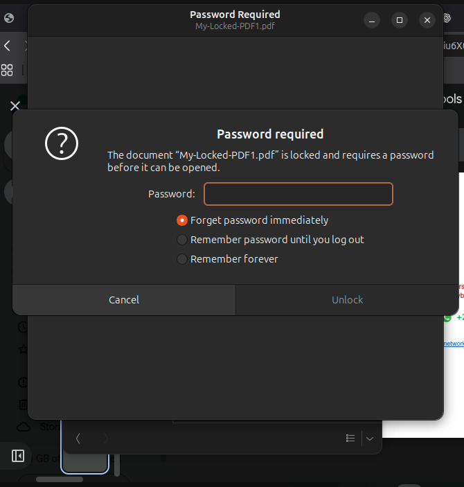
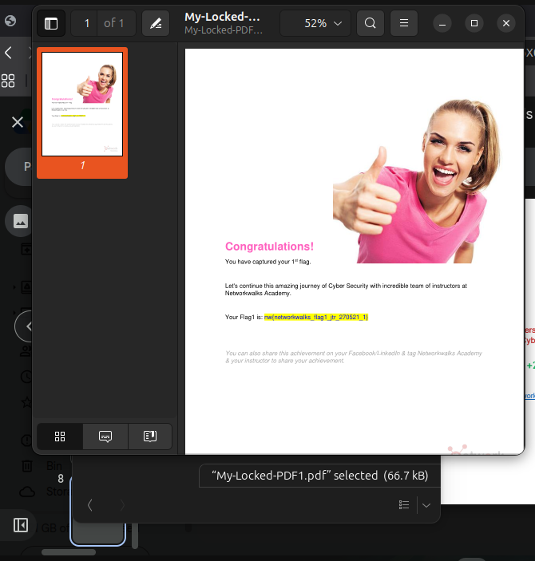

<div align="center">

# 🧩 Password Cracking with Networkwalks' Own Tools: Hash Calculator + Password Cracker

**Week 3, Project Module 2 — cracking `My Locked PDF1.pdf` entirely in the browser, with no installation and no command line**
</div>

<p align="center">
  
  
  
  
  
</p>

---

## 📌 Project Overview

This is **Week 3, Project Module 2 (W3-PM2): Password Cracking with Networkwalks Tools** from the Networkwalks Cybersecurity internship. The task is to crack the password of a locked PDF, `My Locked PDF1.pdf`, using two free browser-based tools built by Networkwalks: the **Hash Calculator** (to pull a crackable hash out of the PDF) and the **Password Cracker** (to run a dictionary attack against that hash). Both tools say everything runs locally in the browser, with nothing uploaded anywhere.

I did this on 17 November 2026, entirely in a web browser, with no installation and no terminal.

This module's target file is the same `My Locked PDF1.pdf` that caused a mix-up in my write-up for **[W3-PM1 (Password Cracking with JTR)]([../NETWORK-WALKS-W3-PM1-Password-Cracking-with-JTR](https://github.com/philip-ajik/NETWORK-WALKS-W3-PM1---Week3---Project-Module1---Password-Cracking-with-JTR-v1))**: I had mistakenly hashed this exact file while working on that other lab, thinking it was PM1's target. Running it properly here, as its own task, confirms that mix-up for what it was — this file belongs to PM2, not PM1.

| 🔎 Item | ✅ Result |
| ------- | --------- |
| Tool 1 | Networkwalks Hash Calculator (networkwalks.com/hash-calculator) |
| Tool 2 | Networkwalks Password Cracker (networkwalks.com/password-cracker) |
| Target | `My Locked PDF1.pdf` |
| Extracted hash | `$pdf$4*4*128*-1060*1*16*55d1a5c14175da449753199e44971d32*32*777fd021a7f3c5ae598c0c6495c7f76e00000000000000000000000000000000*32*ceecdac74b19b5a62688d3b3524e1374c955cbb9cc3c45316494d9446ef81af1` |
| **Cracked password** | **`password1`** (found at attempt 91 of 100 in the built-in wordlist) |
| Confirmed by | Opening the PDF; flag `nw{networkwalks_flag1_jtr_270521}` |

---

## 🎯 Objectives

- Extract a PDF's crackable hash using a browser tool instead of a command-line one
- Understand that the hash format (`$pdf$...`) is the same `pdf2john`/hashcat-compatible format used by John the Ripper itself
- Run a dictionary attack against that hash with a second browser tool
- Confirm the cracked password by opening the actual file
- Compare this approach with the command-line approach from the companion lab, W3-PM1

---

## 🛡️ Why This Matters for Security

This lab makes the same point as W3-PM1, from a different angle: you do not need Kali Linux, John the Ripper, or any installed tool to show that a weak password fails instantly. A password cracker running entirely as a webpage, trying only 100 common passwords, found this one in under 100 attempts. That is the real-world risk of reusing a common password: it does not take specialist tools or a lot of time to find it.

It is also worth noting what these tools say about themselves: the Hash Calculator states that hashing happens locally in the browser and nothing is uploaded, and the Password Cracker's own tagline describes itself as using "the same idea John the Ripper uses." Both tools are reproducing, in JavaScript, the same `pdf2john` hash extraction and dictionary-attack logic as the command-line tools in the W3-PM1 lab.

> ⚠️ **Important:** `My Locked PDF1.pdf` here is a training file supplied by Networkwalks for this exact lab. The same approach should never be used against a file you do not own or do not have permission to test.

---

## ⚙️ Lab Configuration

| 🧩 Component | ⚙️ Configuration |
| ------------ | ---------------- |
| 🖥️ Platform | Web browser only, no installation |
| 🛠️ Tools | Networkwalks Hash Calculator, Networkwalks Password Cracker |
| 🎯 Target | `My Locked PDF1.pdf` (65.2 KB) |
| 📖 Wordlist | Built-in list, 100 passwords |
| 🏆 Scoring | None; the PDF opens to a "Congratulations" flag page instead of a result card |

---

# 🪜 Lab Procedure

## Step 1. Download the locked PDF
I downloaded `My Locked PDF1.pdf` from the lab page to my machine.



## Step 2. Open the Hash Calculator
The Networkwalks Hash Calculator can hash plain text, a generic file, or specifically a PDF. It opens on the **Text** tab by default.



I switched to the **File** tab first, which shows the file is loaded but is meant for generic file hashing (MD5/SHA, not a PDF-specific crackable hash).



## Step 3. Extract the crackable hash from the PDF tab
Switching to the **PDF** tab is what the lab actually needs: the tool reads the file, confirms it is encrypted, and extracts a hash in `pdf2john`/hashcat-compatible format, exactly the same format `pdf2john` itself produces.

```
$pdf$4*4*128*-1060*1*16*55d1a5c14175da449753199e44971d32*32*777fd021a7f3c5ae598c0c6495c7f76e00000000000000000000000000000000*32*ceecdac74b19b5a62688d3b3524e1374c955cbb9cc3c45316494d9446ef81af1
```



## Step 4. Open the Password Cracker and paste the hash
The Password Cracker's own description says it hashes every word in a wordlist and matches it against a PDF password hash, "the same idea John the Ripper uses."



I pasted the `$pdf$...` hash from the Hash Calculator and left the built-in list of 100 passwords active.



## Step 5. Run the attack
Clicking **Start Cracking** works through the wordlist one entry at a time, showing each attempt live.



At attempt 91 of 100, it found a match.

```
[+] MATCH password1
PASSWORD CRACKED SUCCESSFULLY
password1
```



**Answer: `password1`.**

## Step 6. Open the PDF with the cracked password
I opened `My-Locked-PDF1.pdf` and entered `password1`.



It opened, with the flag `nw{networkwalks_flag1_jtr_270521}`.



**Confirmed: `password1` is the correct password for `My Locked PDF1.pdf`.**

---

# 📊 Results

| # | 🎯 Step | ✅ Result |
| - | ------- | --------- |
| 1 | Extract the hash | `$pdf$4*4*128*-1060*...ceecdac74b19b5a62688d3b3524e1374c955cbb9cc3c45316494d9446ef81af1` |
| 2 | Crack the hash | `password1`, found at attempt 91 of 100 |
| 3 | Confirm | PDF opens; flag `nw{networkwalks_flag1_jtr_270521}` |

*Footnote: the lab has no result card or score; the correct password is confirmed by the PDF actually opening and showing its flag text.*

---

# 🔭 Observations Beyond the Task Questions

1. **This is the same file, same hash, same password as the mix-up in my W3-PM1 write-up.** While working on the W3-PM1 lab (Password Cracking with JTR), I mistakenly uploaded this exact file to the browser hash extractor there, thinking it was that lab's target. Running it properly here, as its own task, confirms it: this file belongs to PM2, and `password1` is its correct, intended password.
2. **The Password Cracker's progress log is itself a short lesson in common passwords.** Before reaching `password1`, it tried `football`, `charlie`, `donald`, `qwerty123`, `zaq12wsx`, `service`, `canada`, `hockey`, `killer`, `george`, `asdfgh`, `zxcvbn`, and `qwertyuiop`, among others, all familiar entries from any top-100-passwords list.
3. **The Hash Calculator has three separate tabs** (Text, File, PDF) for three different jobs. The File tab hashes a file's raw bytes (MD5/SHA); only the PDF tab extracts the actual crackable password hash. Using the wrong tab would not have produced a usable hash.
4. **The hash extracted here is byte-for-byte the same format `pdf2john` produces in Kali**, confirming that a browser tool with no installation can do exactly the same first step as a dedicated Linux password-auditing toolchain.
5. **The attack found the password at 91% through a 100-word list**, close to the end, which is a reminder that a short built-in list is not guaranteed to be fast, only eventually complete for whatever it contains.

---

# 🐞 Challenges Encountered

* **No technical blockers for this module.** Both tools worked exactly as the lab describes, on the first attempt, with no installation and no errors.
* **One thing I'd do differently:** this file's similarity to another module's target (both named `My Locked PDF1.pdf` in different lab folders) is what caused the mix-up in my W3-PM1 write-up. Keeping each module's downloaded files in clearly separate, clearly labelled folders from the start would have avoided that entirely.

---

# 💡 Key Learnings

1. A crackable PDF hash can be extracted with nothing more than a browser; the Hash Calculator produces the identical format to `pdf2john`.
2. A dictionary attack does not need a large wordlist to succeed against a weak password; 100 entries was enough here.
3. Browser-based security tools are not a lesser version of command-line ones; they can implement the exact same technique, just with a different interface.
4. This lab also resolved a genuine question from my other write-up: the file I had mistakenly hashed while working on W3-PM1 turned out to be exactly this module's intended target, not a random unrelated file.
5. Keeping files from different modules clearly separated avoids exactly the kind of mix-up that happened here.

---

# 🔐 Security & Ethical Use

This work is for education only. `My Locked PDF1.pdf` is a training file supplied by Networkwalks for this lab, with no real sensitive data inside it. Password cracking tools, browser-based or otherwise, should only ever be run against your own files or files you have explicit written permission to test.

---

# 🔗 Tools & Resources

- **Networkwalks Hash Calculator:** https://networkwalks.com/hash-calculator/
- **Networkwalks Password Cracker:** https://networkwalks.com/password-cracker/
- **NetworkWalks:** https://networkwalks.com

---

# 👤 Author
**Philip Ajik**
Cybersecurity Student (Batch B082) — Networkwalks Academy
LinkedIn: https://www.linkedin.com/in/philip-ajik-a22944384

---

## 📌 Project Information
**Program Name:** Cybersecurity at Networkwalks | **Task:** W3-PM2 | **Project:** Password Cracking with Networkwalks Tools | **Repository:** GitHub
